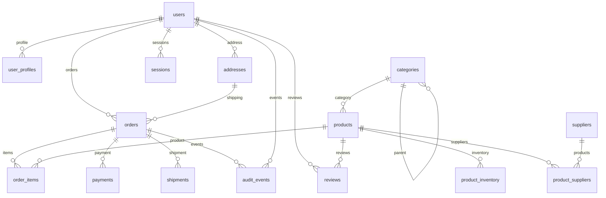

# MySQL Workload Agent

Локальный веб-сервис для управляемой асинхронной нагрузки на разрешенные тестовые MySQL-системы. Два режима: отдельная таблица `workload_agent_data` и полноценная схема интернет-магазина из 15 таблиц с FK, JOIN, агрегациями и транзакциями. Удаление не используется в нагрузочных запросах.

## Запуск

Требуется Docker Engine с Docker Compose v2+; Python и Node.js на хосте не нужны. Порты 8080 и 8000 должны быть свободны.

```bash
cd /home/furzik/agent-bd
# Необязательно: скопируйте и измените лимиты.
cp .env.example .env
docker compose up -d --build
```

- Интерфейс: http://localhost:8080
- Swagger: http://localhost:8000/docs
- Prometheus: http://localhost:8000/metrics
- Health: http://localhost:8000/health
- Readiness с проверкой SQLite: http://localhost:8000/ready

Контейнеры слушают только loopback хоста. Backend работает одним процессом: один владелец workers, пула и паролей. Не запускайте несколько uvicorn workers. SQLite находится в Docker volume `agent_data` и сохраняется между перезапусками.

Остановка:

```bash
docker compose down
```

Обновление после изменения исходников:

```bash
docker compose up -d --build
```

Не используйте `down -v`, если нужна история. При SIGTERM backend прекращает выдачу операций, завершает текущие запросы и batch генератора, закрывает пул и сохраняет отчет. `stop_grace_period` равен часу, поскольку закончить большую batch-транзакцию или проверку БД может быть небыстро. SIGKILL не гарантирует завершение: такая сессия при следующем старте отмечается `INTERRUPTED` с последним сохраненным агрегатом.

## Первый тест

1. Откройте Configuration и заполните Host, Port, Username, Password, Database, Table.
2. `TEST CONNECTION` сохраняет конфигурацию и проверяет сервер. Пароль сразу очищается из поля. Проверка соединения работает и до создания базы, потому что подключается без выбора Database.
3. Настройте workers, общий RPS, payload, SELECT/INSERT/UPDATE и пул; сохраните и повторите проверку.
4. На Dashboard нажмите «Настройки теста» или START: выберите доступную БД, режим, профиль чтения/смешанной нагрузки/записи/транзакций и параметры. Доступные базы загружаются с MySQL через SHOW DATABASES, системные схемы скрыты. Связанный режим доступен только для зарегистрированных READY-баз на текущем endpoint.
5. Настройте длительность в секундах и/или лимит операций (0 = без ограничения). По первому достигнутому пределу агент автоматически выполняет STOP и сохраняет отчет. Подтвердите target и нажмите START TEST; настройки сохранятся, подключение повторно проверится перед стартом.
6. PAUSE приостанавливает выдачу новых операций; уже выполняющиеся завершаются. RESUME продолжает ту же сессию. STOP сохраняет итоговый отчет в Reports.

`localhost` в поле Host означает backend-контейнер. Для MySQL на этом компьютере используйте `host.docker.internal`, для внешней БД ее IP/DNS. MySQL должен слушать доступный контейнеру интерфейс, а firewall и пользователь должны разрешать соединение с адреса Docker-сети.

По умолчанию создается только указанная отдельная тестовая таблица. Идентификаторы строго проверяются, SQL-значения передаются параметрами. Никогда не выбирайте рабочую пользовательскую таблицу как test table. Отдельный пользователь с правами лишь на тестовую БД ограничивает последствия ошибки конфигурации.

## Создание большой базы

После успешного Test connection откройте Test Databases и нажмите CREATE TEST DATABASE. Имя должно начинаться с `workload_test_`; генератор предлагает уникальное имя. Если имя уже существует, создание прекращается без изменения этой базы.

Параметры: SMALL (10 000), MEDIUM (100 000), LARGE (1 000 000), VERY LARGE (5 000 000), CUSTOM (до server-side лимита); количество записей означает суммарное число строк в 15 основных таблицах. Минимум 150 позволяет заполнить каждый тип сущности. Отдельно задаются payload и batch size. Перед запуском показаны сервер, имя, число строк, таблиц и грубая оценка размера. Для подтверждения требуется точное имя базы.

Генерация идет в порядке родителей и потомков. Каждый batch вставляется через `executemany`, транзакция фиксируется целиком. Объем batch дополнительно ограничивается примерно 2 MB плюс протокольные накладные расходы. Родительские ID берутся только из реально существующих записей. Память ограничена текущим batch и до 10 000 ID на родительскую таблицу. Все имена, адреса, email (`example.invalid`), IP (тестовая сеть 192.0.2.0/24), SKU и token hash синтетические.

Схема:



После генерации проверяются 15 таблиц, PK, запрошенные FK и индексы, orphan-ссылки, число строк, SELECT, JOIN, реальные INSERT/UPDATE с ROLLBACK. Заказы и платежи согласуются с суммой позиций. При READY база автоматически сохраняется в конфигурации и включается relational workload: можно сразу нажать START TEST. Если Generate Initial Data выключено, структура создается и проверяется, но START требует сначала ADD RANDOM DATA.

CANCEL заканчивает текущий batch и сохраняет частичную БД. Затем пользователь отдельно решает, удалить ли ее, через DELETE. Никакая база не удаляется автоматически. ADD RANDOM DATA дополняет READY-базу, сохраняя FK. CLEAR удаляет строки child-first в транзакции без отключения FOREIGN_KEY_CHECKS. DELETE выполняет DROP DATABASE только после проверки реестра SQLite и `_agent_owner` token, с отдельным вводом точного имени. Для START, USE FOR TEST и CLEAR/DELETE смена UUID за тем же HA endpoint допустима только при совпадении `_agent_owner` token; смена сервера записывается в системные события, исходный UUID в реестре сохраняется. CLEAR/DELETE дополнительно проверяют read_only и super_read_only на том же соединении и разрешены только на доступной для записи ноде. Нагрузку и генерацию нужно остановить до этих операций. Сторонние базы не принимаются в реестр через API.

## Пользователь MySQL и права

SQL выполняет администратор MySQL, приложение не создает учетных записей. Замените пример пароля и source IP на свои. Не используйте root для обычной нагрузки.

Режим одной таблицы, заранее созданная отдельная база:

```sql
CREATE DATABASE agent_test CHARACTER SET utf8mb4;
CREATE USER 'workload'@'172.18.%' IDENTIFIED BY 'replace-with-a-long-random-password';
GRANT SELECT, INSERT, UPDATE, CREATE ON agent_test.* TO 'workload'@'172.18.%';
```

Если таблица заранее создана, отключите auto-create и не выдавайте CREATE. Права можно ограничить конкретной таблицей.

Генерация схемы с заранее выбранным именем (базу заранее НЕ создавайте):

```sql
CREATE USER 'workload_builder'@'172.18.%' IDENTIFIED BY 'replace-with-a-long-random-password';
GRANT SELECT, INSERT, UPDATE, CREATE, ALTER, INDEX, REFERENCES
  ON workload_test_example.* TO 'workload_builder'@'172.18.%';
```

В диалоге укажите `workload_test_example`. Права CREATE на уровне конкретной схемы разрешают CREATE DATABASE с этим именем, глобальный ALL PRIVILEGES не требуется. Предварительная проверка читает SHOW GRANTS и принимает прямые grants на точную БД или глобальный scope. Если используются роли, выдайте генератору прямые scoped grants; приложение не пытается самостоятельно включать роли или расширять права. CREATE для генератора - разрешенное явное исключение из обычного набора нагрузочных SQL.

Для явно запрашиваемой очистки и удаления только этой базы, при необходимости:

```sql
GRANT DELETE, DROP ON workload_test_example.* TO 'workload_builder'@'172.18.%';
```

Для обычной нагрузки на уже созданную связанную схему достаточно SELECT, INSERT, UPDATE на этой тестовой БД. Можно переключиться с builder на workload-пользователя после генерации и снова пройти Test connection.

Опциональный мониторинг репликации:

```sql
GRANT REPLICATION CLIENT ON *.* TO 'workload'@'172.18.%';
```

Это право нужно SHOW REPLICA STATUS, а не нагрузке или генератору. Без него интерфейс отображает UNKNOWN, не объявляет writable-сервер достоверным primary. `super_read_only` может быть недоступен в некоторых версиях. Поддерживаемая целевая версия - MySQL 8.0/8.4 (генератор использует JSON и server_uuid); частичная совместимость MariaDB не означает поддержанный генератор.

## Нагрузка, лимиты и статистика

`.env`:

| Variable | Default | Meaning |
| --- | ---: | --- |
| MAX_WORKERS | 500 | Максимум workers |
| MAX_RPS | 100000 | Верхняя граница вводимого общего RPS |
| MAX_PAYLOAD_BYTES | 5242880 | Максимальный ASCII payload |
| MAX_CONNECTIONS | 1000 | Максимальный пул с резервом 2 служебных connections |
| MAX_GENERATOR_ROWS | 20000000 | Максимум строк за генерацию |
| BACKEND_PORT | 8000 | Loopback HTTP API |
| FRONTEND_PORT | 8080 | Loopback интерфейс |

Лимит - разрешенный потолок, не обещание производительности. Генерация payload, SQLite, MySQL и CPU определяют фактический throughput. Бэкенд сам проверяет пределы, суммы процентов, payload min/max и pool min/max. `PACED` равномерно распределяет старт операций между всеми workers без накопления долга; `TOKEN_BUCKET` допускает ограниченный burst (до 100 операций / 100 ms). Задержка worker и недостаточный пул могут снижать фактический RPS.

Relational workload содержит более 70 безопасных шаблонов: простые и range SELECT всех 15 таблиц, 2-4-table INNER/LEFT JOIN, COUNT/SUM/AVG с GROUP BY, INSERT/UPDATE всех таблиц и 4 транзакционных сценария. Создание пользователя здесь означает INSERT синтетических сущностей, не SQL CREATE USER. SELECT не использует ORDER BY RAND: выбор по MAX(id) и индексный seek `id >= random_id`, что работает с разрывами ID, но не дает равномерную выборку строк при больших разрывах. UPDATE всегда ограничен WHERE и одной строкой.

Simple/JOIN/Aggregate/INSERT/UPDATE/Transactions имеют отдельные веса. Query Complexity определяет состав SELECT-пула внутри simple-класса: LOW - одна таблица, MEDIUM - также JOIN 2 таблиц, HIGH - многотабличные JOIN/агрегации, RANDOM - смешивание. Явно заданные JOIN/Aggregate веса продолжают действовать. Scheduler повышает вес давно не использованных таблиц в выбранном классе. При конфигурации, исключающей все шаблоны некоторой таблицы (например, только HIGH SELECT), 100% покрытия недостижимо; ориентируйтесь на фактическую TABLE COVERAGE. Для полного покрытия используйте default mixed distribution.

INDEXED использует PK/FK/range шаблоны. MIXED добавляет ограниченные менее оптимальные фильтры в небольшом ID-диапазоне. Payload UNIFORM/RANDOM/SMALL_HEAVY/LARGE_HEAVY задает распределение размеров; ASCII означает 1 символ = 1 byte. TEXT/LONGTEXT-поля получают payload; поля со статусами сохраняют реалистичную ограниченную длину.

RPS и total requests считают workload-операции; одна транзакция - один сценарий, а не один SQL. `statements` фиксирует число основных SQL в сценарии; служебные lookup/metadata SQL не включены в лимит операций. Rows affected учитывает реально измененные MySQL строки. Failed-транзакция имеет ROLLBACK и не увеличивает committed rows counters. Bytes read - сериализованный размер возвращенных полей, bytes generated - переданные строковые параметры основных успешных записей; это не счетчик TCP/IP-трафика.

По каждому выполнению в SQLite сохраняется timestamp UTC, session_id, worker, template/class, таблицы, target, latency, время ожидания пула, payload size, rows, success, безопасный error category и MySQL code. `connection_time_ms` для workload - ожидание acquire из пула; отдельная Test connection измеряет новое соединение. Полный SQL и payload не сохраняются. Timeout не доказывает, что autocommit INSERT не попал в БД: такие запросы автоматически не повторяются, последующие независимые операции продолжаются. По умолчанию каждое физическое соединение обновляется после 5 операций нагрузки: счетчик общий для использующих его workers. Соединение закрывается после завершения операции/COMMIT и до возврата в пул; следующий acquire создает новое. Порог настраивается в Configuration → Pool & reliability → Refresh connection after requests. Плановые обновления учитываются как `connection_refreshes` и `mysql_agent_connection_refreshes_total`, не как ошибки или failover reconnects. При потере соединения применяется exponential backoff 1/2/4/8/... до настраиваемого предела.

Точные cumulative counts/min/max/mean; P50/P95/P99 рассчитаны по reservoir sample до 20 000 операций. По типу - последнее окно до 5000. Графики сохраняются раз в секунду; экранный отчет и API просмотра показывают до примерно 2000 точек; отдельный экспорт JSON/CSV/DOCX сохраняет все точки, исходные точки остаются в SQLite. Browser log ограничен 1000, slow list - 100, ошибки на странице отчета - последние 200; CSV содержит все операции, параметры, историю и события; полный исходный объект каждой строки доступен в колонке data. Aggregation/SQLite используют backpressure, записи не сбрасываются ради RPS. Следите за свободным местом: история не удаляется автоматически.

Reports содержит конфигурацию без пароля, начало/конец/длительность, RPS/latency, ошибки, строки и bytes, coverage, таблицы и slow templates, транзакционные результаты и failover events. Reset statistics разрешен после STOP и не удаляет историю отчетов.

## Nodes и failover

Можно добавить до 32 monitoring nodes. Мониторинг использует по одному последовательному служебному соединению, чтобы не раздувать max connections. Каждая нода показывает connection status/latency, hostname/server_id, version, read_only/super_read_only, uptime, connected/running threads, delta Queries/sec и доступные replication IO/SQL/lag/source. Queries/sec включает сторонний трафик MySQL, не только агент.

Workload всегда использует явно выбранный host (proxy/VIP/DNS поддерживается). Агент не выполняет promotion и не переключает запись на случайную writable replica. Изменение наблюдаемого primary за target endpoint дает MASTER_CHANGED с old/new, временем и известным downtime. CONNECTION_LOST/RESTORED отслеживаются по workload failures/recovery. Наблюдение опрашивается раз в 5 секунд: мгновенное переключение между опросами может быть не замечено. Недоступные replication права приводят к UNKNOWN, а не предположению по имени сервера.

## Архитектура

```text
browser React/TypeScript/Recharts
    -> nginx :8080
        -> FastAPI :8000 REST + WebSocket /ws/live
            -> AgentManager -> global limiter -> workers -> asyncmy pool -> MySQL
            -> DatabaseManager -> batch generator -> managed relational schema
            -> NodeMonitor -> status/replication
            -> Collector -> bounded live buffers + SQLite writer queue
            -> reports / Prometheus registry
SQLite volume: config without password, sessions, each operation, charts, events, managed DB registry
```

WebSocket передает агрегаты раз в секунду и накопившийся ограниченный log batch, не отдельное событие на каждый SQL. Slow clients отключаются по send timeout. Uvicorn access log отключен; системные события stdout - JSON. Driver exceptions переводятся в категории: сырые сообщения могут содержать SQL/секреты и поэтому не журналируются.

Пароли только в RAM backend, не возвращаются API, не попадают в SQLite, метрики или browser console. Валидационные ошибки API не возвращают исходный request input. После restart пароли вводятся повторно. Фронтенд использует uncontrolled password input и очищает его при отправке. REST-запись/WebSocket проверяют browser Origin; публичной аутентификации нет, поэтому оставьте loopback bind. Не публикуйте сервис напрямую в интернет.

Prometheus: requests/success/failed, SELECT/INSERT/UPDATE, histogram duration, connections, connection errors, reconnects, payload bytes, rows read/written, running. На cumulative-счетчиках только host/query_type; текущий session_id - одна заменяемая info gauge, чтобы новые сессии не создавали бесконечную cardinality.

## API

| Method | Path | Action |
| --- | --- | --- |
| GET | /health, /ready | Health/readiness |
| GET | /api/status, /api/metrics/current | Agent state/statistics |
| GET / POST | /api/config | Read/save config without password echo |
| GET | /api/connection/databases | Доступные БД текущего MySQL endpoint |
| POST | /api/connection/test | Test saved or supplied connection |
| POST | /api/agent/start, stop, pause, resume, reset | Control |
| GET | /api/reports | Session history |
| GET | /api/reports/{id} | Full report |
| GET | /api/reports/{id}/export?format=csv\|json | Export |
| GET / POST | /api/nodes | Monitor list/add |
| DELETE | /api/nodes/{id} | Remove monitor |
| GET | /api/databases | Managed databases |
| POST | /api/databases/create | Confirmed creation job |
| GET | /api/databases/progress | Generator state |
| POST | /api/databases/cancel | Finish current batch and cancel |
| GET | /api/databases/{id}/structure | Schema/FK/indexes |
| POST | /api/databases/{id}/use, add, clear, delete | Managed database actions |
| GET | /metrics | Prometheus |
| WS | /ws/live | Aggregates/logs/progress/nodes |

Конкретные модели и ограничения смотрите в Swagger. `POST /api/config` принимает `{connection: {...}, workload: {...}}`; password необязателен, отсутствующее поле сохраняет текущий пароль на том же host/port/username. Изменение учетной записи сбрасывает пароль и verified flag. START выполняет повторный реальный connect и проверку схемы даже после успешного Test connection.

## Проверки и разработка

Frontend:

```bash
npm ci --prefix frontend
npm run build --prefix frontend
```

Backend, Python 3.12:

```bash
cd backend
python -m venv .venv
.venv/bin/pip install -r requirements-dev.txt
.venv/bin/pytest -q
```

Тесты проверяют ограничения и защиту идентификаторов, исключение секретов из сериализации/validation errors/WS, global rate limiter, остановку при малом RPS, SQLite persistence, endpoint guards и полноту шаблонов.

`scripts/integration.py` проверяет настоящий MySQL через API: генерация, workload всех таблиц, транзакции, pause/resume, STOP, CSV/JSON и ADD RANDOM DATA. Он предназначен **только для отдельной disposable системы** и требует `VERIFY_MYSQL_HOST`, `VERIFY_MYSQL_USER`, `VERIFY_MYSQL_PASSWORD`; имя БД по умолчанию `workload_test_verification`. Повторный запуск на существующей базе намеренно запрещен. Скрипт не запускает MySQL и не удаляет базы автоматически.

## Troubleshooting

- `docker compose ps`: оба контейнера должны быть healthy. `docker compose logs backend` показывает безопасные system events.
- `Authentication denied`: проверьте password и MySQL host part пользователя; `%` не решает firewall/bind_address.
- `Connection unavailable`: проверьте адрес из Docker-сети, 3306, firewall, proxy/VIP. `localhost` внутри контейнера - не хост.
- `Unknown database`: создайте отдельную БД администратором либо используйте CREATE TEST DATABASE.
- `Insufficient privileges`: выдайте scoped права на тестовую базу, не глобальный административный grant. CLEAR/DELETE требуют отдельные DELETE/DROP права.
- `Required direct grants`: preflight не раскрывает password; проверьте SHOW GRANTS и точное имя будущей схемы.
- `Server is read-only`: используйте корректный writer endpoint; агент не меняет read_only и не делает promotion.
- `Populate all managed tables`: пустую/очищенную схему сначала заполните через ADD RANDOM DATA.
- `No inventory available`: транзакция заказа откатывается, пополните inventory/данные. Длительная write-heavy нагрузка закономерно расходует остатки.
- `Internal operation failed` / `/ready` 503: проверьте свободное место volume, SQLite и состояние writer. Не запускайте второй backend поверх того же файла.
- RPS ниже цели: измерьте latency, CPU, pool maximum, payload и скорость диска. `workers / latency` ограничивает достижимый RPS.
- Charts недоступны: nginx должен проксировать WebSocket Upgrade, браузер и API должны быть доступны на одном origin. Интерфейс переподключается каждые 2 секунды.
- Нет replication fields: нужны REPLICATION CLIENT и поддерживаемые команды MySQL. UNKNOWN допустим, не требует SUPER.

## Проверка сохранности записей

В Настройках теста или Configuration включите «Проверять сохранность записей». Выберите БД и подтвердите запуск. При разрешенном auto-create агент создаст отдельную таблицу `workload_agent_integrity`; иначе таблица должна существовать. Сценарий каждого worker: INSERT с уникальным probe_id и revision=1, SELECT и точная сверка payload/revision, UPDATE той же записи с новым payload и revision=2, повторный SELECT и сверка. Каждая запись принадлежит только одному циклу, чтения идут после autocommit записи. Цикл не является одной транзакцией: проверяется реально зафиксированная запись. Даже пустой payload проверяется по revision. Проценты обычной нагрузки в этом режиме не применяются.

RPS ограничивает все четыре SQL-запроса через общий limiter; лимит операций и метрики total/RPS обозначают циклы, SQL REQUESTS / SEC показывает SQL-запросы. При STOP текущие циклы завершаются с учетом общего RPS; каждый SQL имеет query_timeout, общий защитный таймаут цикла учитывает четыре SQL и ожидание limiter (4 × query_timeout + 4 × workers / RPS). Обновление соединения выполняется после настроенного числа циклов; при потере связи цикл не переигрывается. Записи сохраняются, объем таблицы растет; автоматического удаления нет.

Dashboard и Reports показывают счетчики и график `integrity_loss_rps`: отсутствие строки или несовпадение payload/версии после INSERT либо UPDATE. Каждая завершенная проверка учитывается отдельно, поэтому один цикл может иметь два несовпадения. SQL/transport ошибки и таймауты дают незавершенные проверки `integrity_inconclusive`, а не автоматически доказанную потерю. Поля стадии, probe_id и причины сохраняются в событиях SQLite/CSV/JSON без payload. Это проверка видимости/сохранности данных, а не захват сетевых пакетов: несовпадение может означать лаг реплики или последствия failover. Prometheus экспортирует mysql_agent_integrity_checks_total, mysql_agent_integrity_lost_writes_total, mysql_agent_integrity_inconclusive_total.

## Полный экспорт отчетов

На странице Reports доступны Export JSON, Export CSV и Export DOCX. Endpoint: `GET /api/reports/{session_id}/export?format=json|csv|docx`. Ограничения экранного просмотра (сокращенные графики и последние 200 ошибок) не применяются к экспорту.

JSON включает конфигурацию, сводку, всю историю `history`, все операции `requests`, все ошибки `errors` и системные `events`. CSV содержит строки разных типов (`record_type`): метаданные сессии, параметры, сводку, сведения о снимке, history, request, event. Столбец `data` содержит полный JSON исходной записи со всеми полями, включая вложенные структуры и новые метрики; остальные колонки предназначены для быстрого анализа операций. Одна ошибочная операция присутствует как request с success=false. CSV кодируется UTF-8 с BOM.

DOCX содержит параметры, все поля статистики, полную историю показателей, каждую операцию и все системные события. Подробные данные помещаются в текстовые приложения в JSON-представлении без усечения. Большие сессии дают большие Word-документы; для машинного анализа удобнее JSON/CSV. Генерация DOCX выполняется порциями с ограничением одновременно работающих генераторов, файлы удаляются после скачивания.

Экспорт фиксирует границы данных одним SQLite-запросом и не включает записи, добавленные после снимка. Для активного теста это все уже сохраненные записи, а не еще выполняющиеся запросы; сводка активного теста соответствует последнему сохраненному обновлению. В `export` записаны время снимка и точное число сохраненных операций, ошибок, точек и событий. Для завершенного теста все операции предварительно сохраняются при STOP. Пароли и payload в отчеты не добавляются.

График Read / write activity показывает SELECT/INSERT/UPDATE SQL в секунду, включая SQL внутри INTEGRITY и транзакций. На один завершенный проверочный цикл приходится 2 SELECT, 1 INSERT и 1 UPDATE. Учитываются команды, успешно завершенные драйвером, включая команды до последующей ошибки или rollback; их выполнение не означает обязательный COMMIT транзакции. SQL с ошибкой и запросы, не дошедшие до БД, не учитываются как завершенные. Счетчики `sql_select_total`, `sql_insert_total`, `sql_update_total` сохраняются отдельно от числа циклов; Prometheus select/insert/update_total также включает вложенные SQL.

## Режимы теста и пресеты

В Настройках теста и Configuration доступны три режима: NORMAL (обычная нагрузка), INTEGRITY (только проверка сохранности), MIXED (оба вида одновременно). В MIXED параметр integrity_percent задает долю выбираемых проверочных циклов, строго между 0 и 100. Остальные операции следуют обычному распределению процентов: одной тестовой таблицы или всей зарегистрированной связанной БД. Эти обычные проценты отдельно суммируются до 100. Например, при integrity_percent=20 и SELECT=70 около 20% выбранных операций являются проверочными циклами, а 56% — обычными SELECT. Это вероятностное распределение на продолжительном тесте, не жесткая квота каждого секундного окна.

Проверки используют отдельную workload_agent_integrity; обычная нагрузка не меняет эти записи. При START в MIXED проверяются оба набора таблиц, ownership-маркер для связанной БД и наличие данных в ней; при auto-create создаются нужные отдельные таблицы. Для TABLE выберите другое имя таблицы, не workload_agent_integrity. Общие workers, connection pool и limiter используются обоими видами нагрузки. RPS задает бюджет токенов: обычная операция или транзакционный сценарий расходует один токен, проверочный цикл четыре. Вложенные SQL обычного сценария не меняют прежнюю семантику RPS; график SQL/sec показывает фактические выполненные команды шаблонов. Лимит max_requests считает выбранные операции/циклы обоих видов вместе. Ошибки и таймауты проверок не применяются к обычным операциям. Старый integrity_test автоматически мигрирует в INTEGRITY; mode имеет приоритет при явном указании обоих полей.

Готовые пресеты: Сбалансированный, Чтение, Запись, Транзакции, Сохранность данных, Нагрузка и сохранность (20% проверок), Проверка failover (50% проверок). Preset failover генерирует нагрузку для наблюдения за переключением, не инициирует переключение MySQL. Любой параметр можно изменить после выбора; интерфейс обозначает такие настройки как «Свои параметры». Пресеты задают workers/RPS/payload и распределение, сбрасывают ограничения длительности/числа операций в 0 и задержку в 0; значения ограничиваются лимитами сервера. БД и учетные данные пресеты не меняют. Действующие настройки сохраняются в SQLite и отчете сессии.
